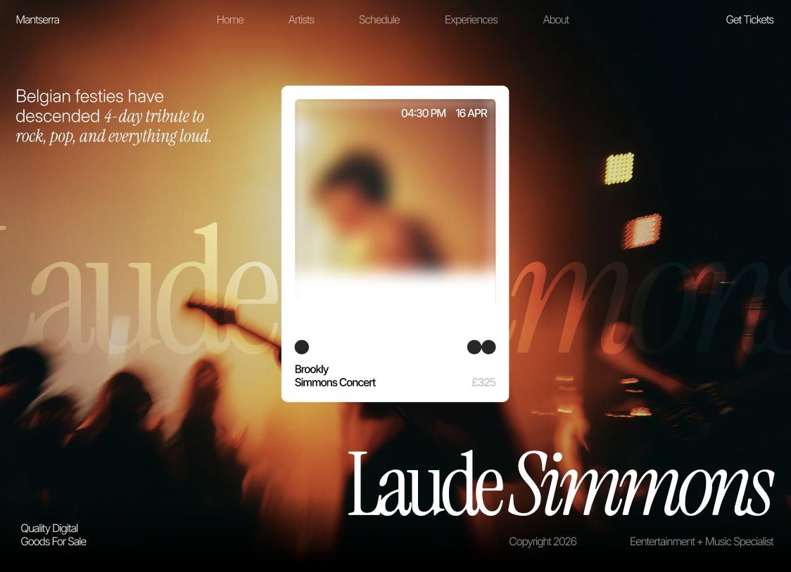

# Mantserra Studio

**A curated celebration of music, art, and atmosphere.**

Mantserra adalah landing page untuk platform musik dan pengalaman live yang mempertemukan artis, kurator, dan penikmat musik. Desainnya memadukan fotografi konser yang sinematik, tipografi editorial, serta perpaduan warna amber, hitam, dan cream.

Identitas utamanya hadir melalui hero Laude Simmons, kartu tiket dengan efek kaca dan blur, pilihan experiences, sorotan artis, jadwal pertunjukan berbentuk accordion, editorial updates, dan wordmark Mantserra yang besar pada footer.

[Live Preview](https://mantserra-studio.vercel.app/) · [Figma Design](https://www.figma.com/design/C2rhn7BP2nXA0LyByRDn09/Speedtest?node-id=3915-352)

## Teknologi

HTML, CSS, dan JavaScript ES modules, dengan Vite untuk build, GSAP + ScrollTrigger untuk animasi, dan Lenis untuk smooth scrolling. Layout responsif dengan dukungan reduced motion.

## Pengembangan

Lihat [panduan pengembangan](docs/development.md) untuk menjalankan project, struktur source, dan catatan implementasi.
