# Audit responsif Mantserra

Pemeriksaan lokal pada 16 November 2026, melalui Chrome Device Toolbar. Ukuran yang diperiksa: 320 × 1024, 393 × 852, 768 × 1024, dan 1024 × 1024. Zoom preview 50% hanya mengecilkan tampilan emulator, bukan ukuran CSS halaman. Capture tablet 1024px tinggi menampilkan sekitar 1020px area konten karena batas panel browser.

## Hasil per langkah

| Langkah | Area | Hasil dan perubahan |
| --- | --- | --- |
| 1 | Header dan hero | Menu mobile membuka/menutup dan tautan menuju section. Kartu diperkecil pada lebar di bawah 360px. Lebar introduction dibatasi sesuai gutter; ukuran signature mobile diturunkan. Jarak kartu hero tablet diperbesar untuk menghindari pertemuan dengan introduction. |
| 2 | Experiences | Grid dua kolom muat pada tablet/mobile. Filter Alternative diuji dan tetap mengisi empat kartu. Kartu hitam tetap hitam. Efek overlap dimatikan pada ukuran kecil/touch agar filter tidak tertutup section berikutnya. |
| 3 | American Football | Dua kolom pada tablet, satu kolom pada mobile. Detail artist menjadi satu kolom pada lebar 480px ke bawah. Flip kartu diuji pada 320px; huruf belakang kartu diperbesar untuk mobile. |
| 4 | Schedule | Accordion Opening Set dibuka dan Headliner tertutup. Tiga gambar muat. Informasi dan deskripsi menjadi satu kolom pada 480px ke bawah agar paragraf tidak terlalu sempit. |
| 5 | Updates | Pin horizontal dibatasi ke desktop minimal 1024px dengan fine pointer dan hover. Tablet/mobile memakai overflow horizontal native dengan scroll snap; teks tetap terlihat pada mobile. Kartu kedua berhasil dijangkau dengan Tab. |
| 6 | Footer | Overflow nyata pada 320px diperbaiki: track grid sekarang minmax(0, 1fr), deskripsi mengikuti lebar kolom, form tidak lagi mendorong tombol Send keluar layar. |
| 7 | Dialog tiket | Dibuka dan ditutup pada 393 × 852. Judul, tanggal, jam, harga dan pemberitahuan pemesanan muat dalam viewport. |

## Motion dan aksesibilitas

- GSAP quickTo untuk pembesaran kartu dipecah menjadi scaleX dan scaleY, memperbaiki peringatan berulang di console.
- Tombol Menu/Get Tickets pada mobile kecil memiliki tinggi minimum 44px.
- Reduced motion tetap memiliki pergantian sisi kartu langsung dan scroll native.
- Label aria dan tombol keyboard tetap dipertahankan. Pemeriksaan ini bukan sertifikasi WCAG; kontras dan screen reader belum diaudit menyeluruh.

## Batas verifikasi

Ini adaptasi responsif dari desain desktop. Frame mobile Figma belum diberikan, sehingga tidak mengklaim kecocokan terhadap desain mobile Figma. Pengujian visual menggunakan emulator Chrome, bukan perangkat fisik atau Safari iOS. Gesture swipe fisik, keyboard virtual, perubahan browser chrome/safe area, dan performa perangkat tetap perlu pengecekan di perangkat asli. Perpindahan horizontal Updates telah dibuktikan dengan fokus keyboard; gesture drag emulator tidak memberikan bukti swipe yang dapat diandalkan.

Build Vite dan pemeriksaan CSS blur produksi lulus. Perubahan hanya lokal, belum dideploy.

## Screenshot

Screenshot dipotong ke area viewport halaman agar toolbar dan tab browser lain tidak ikut tersimpan. Pemotongan tidak mengubah isi layout.

### 1. Header / hero

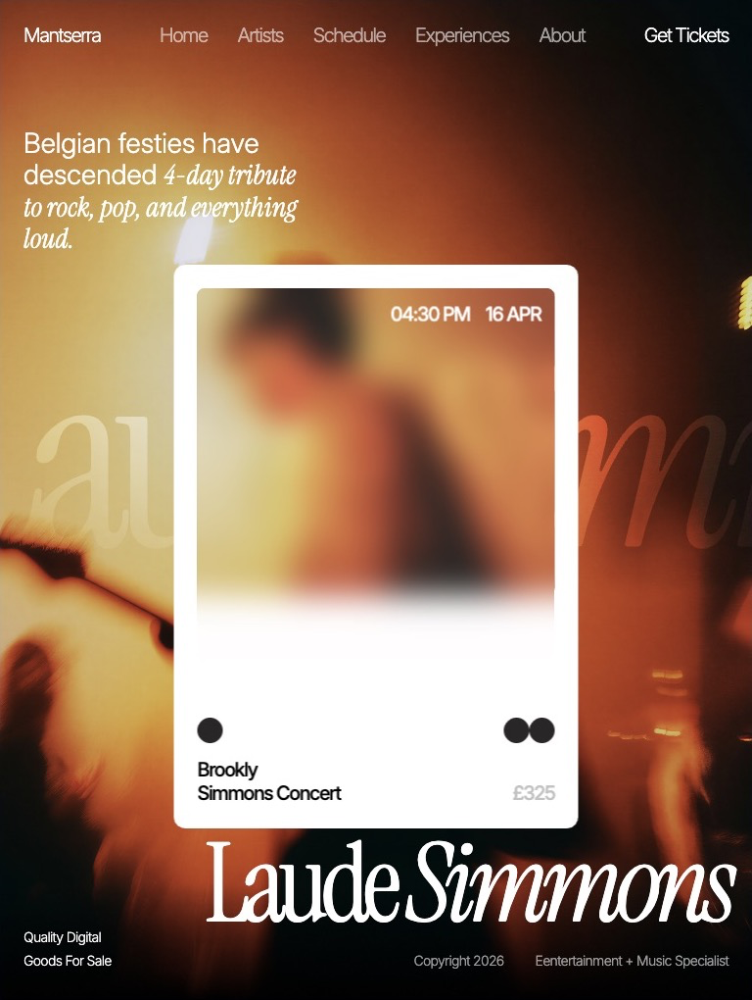

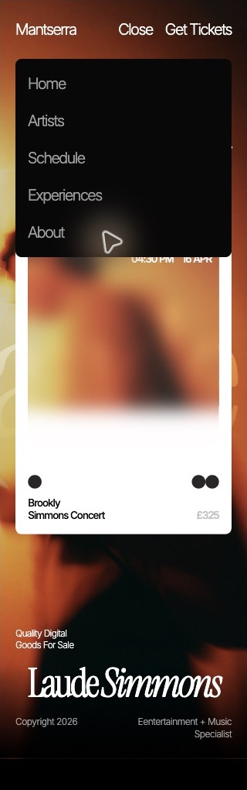

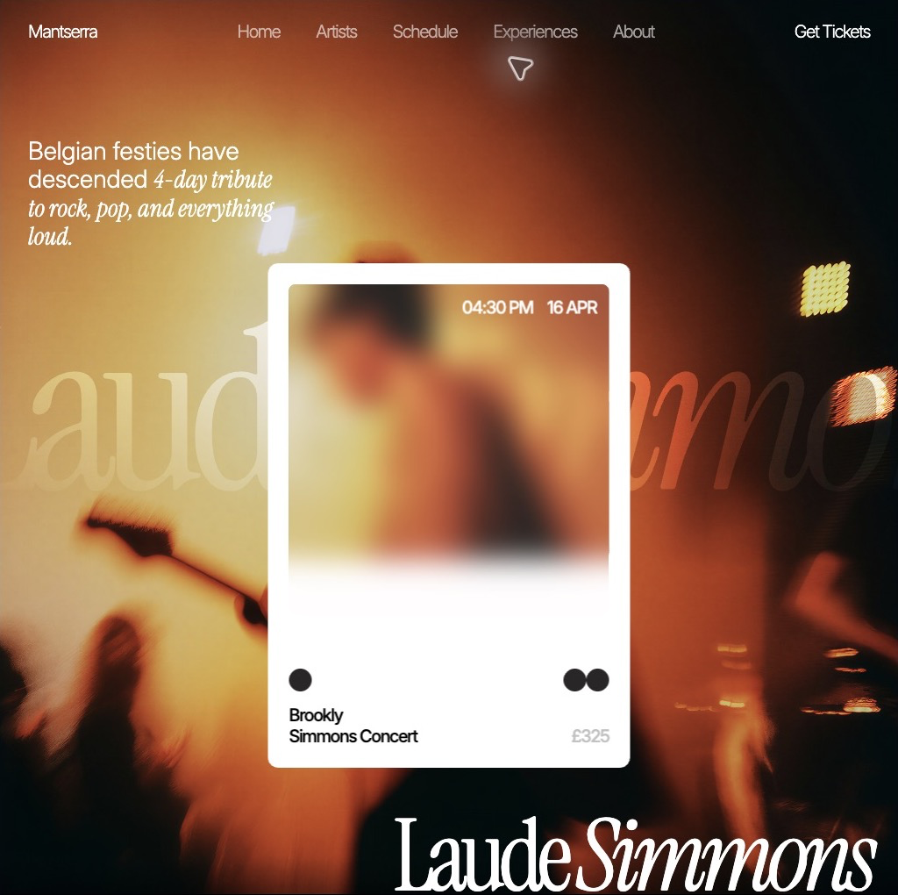

### 2. Experiences

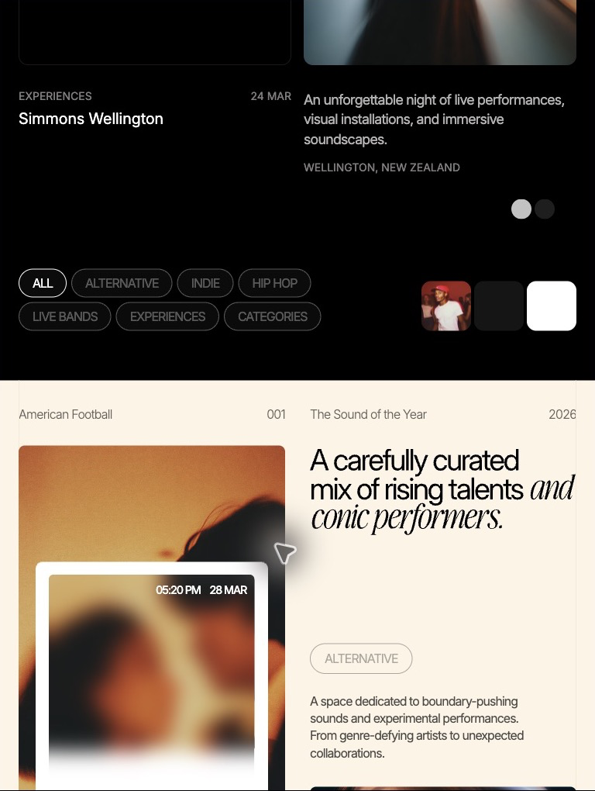

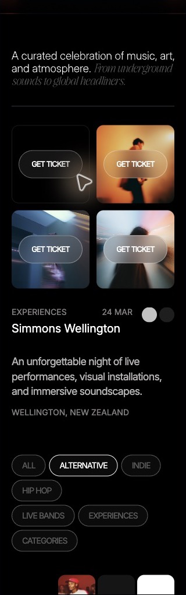

### 3. Artist

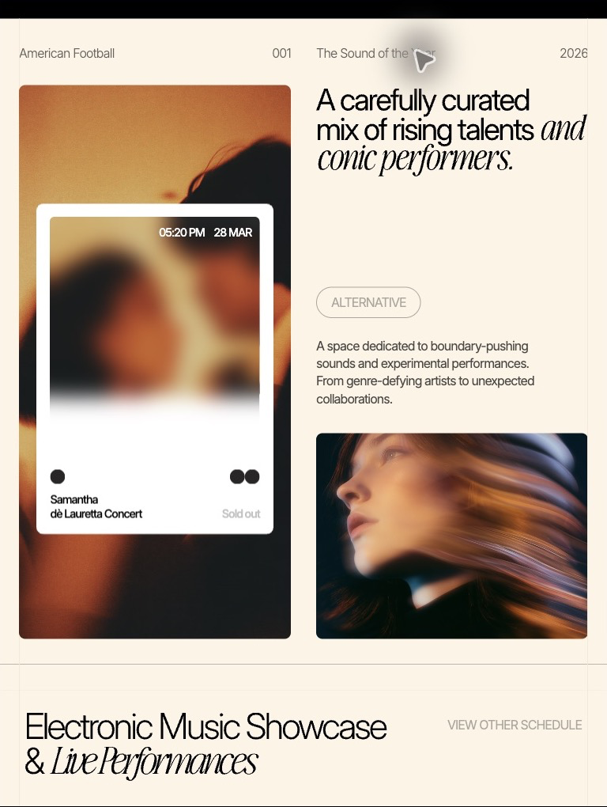

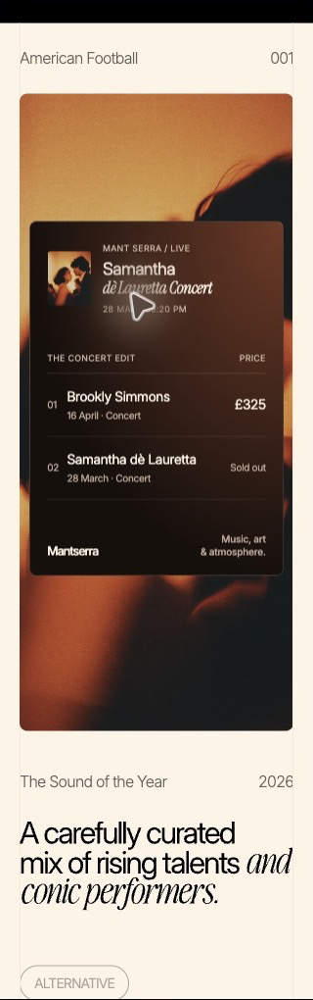

### 4. Schedule

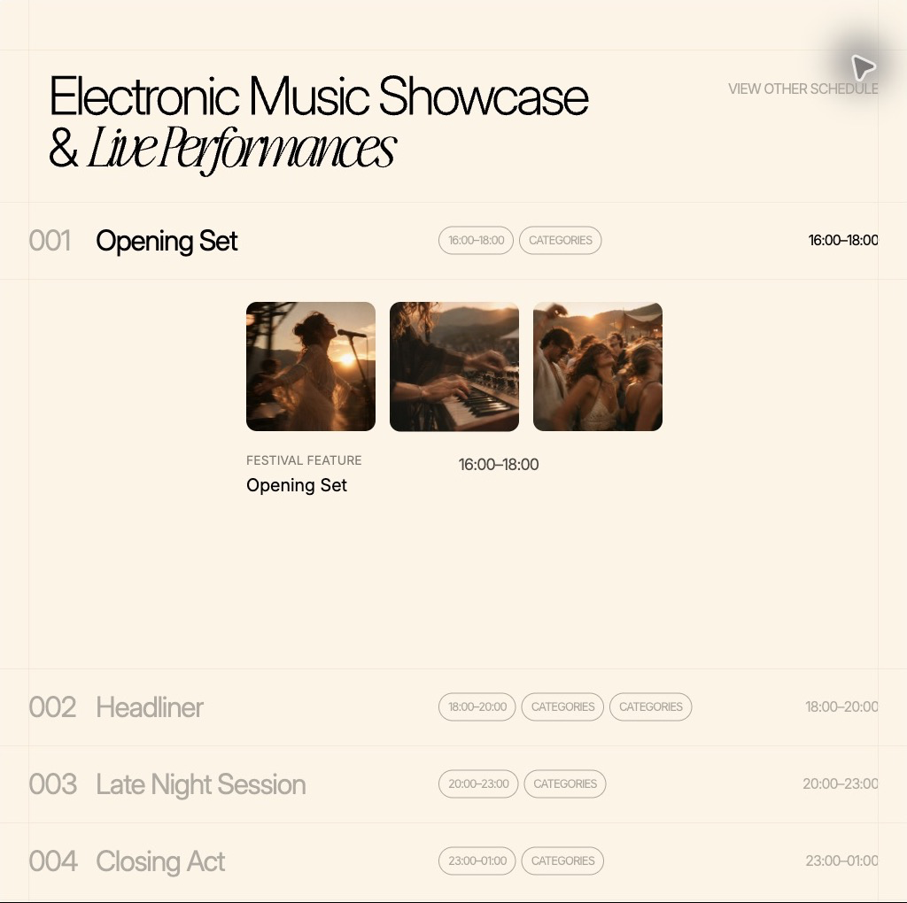

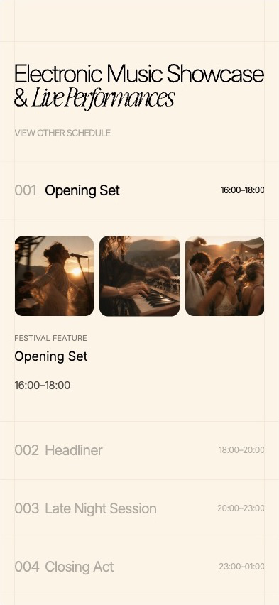

### 5. Updates

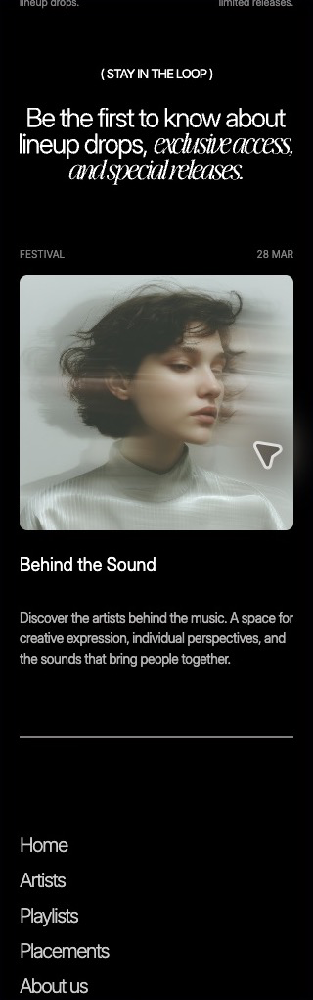

### 6. Footer

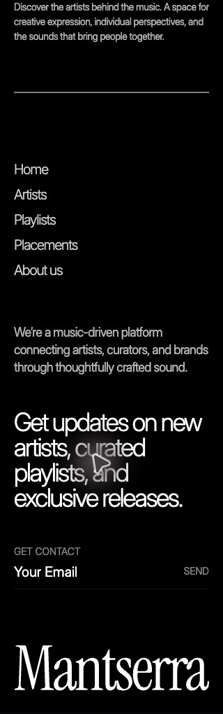

### 7. Dialog

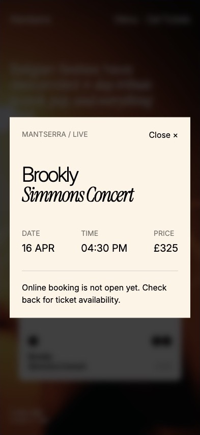
